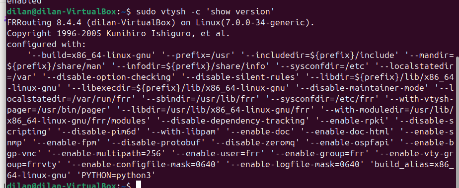
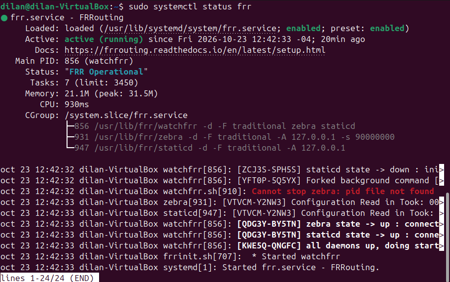
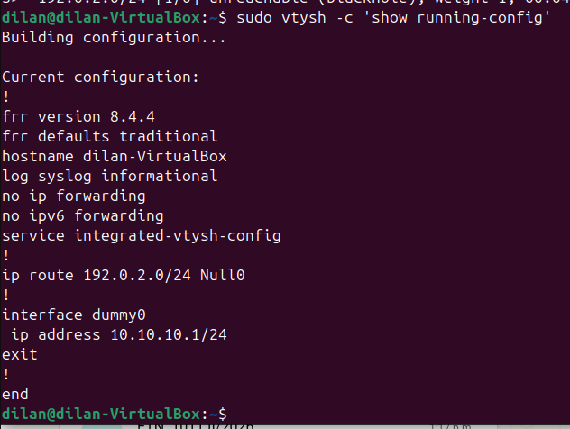
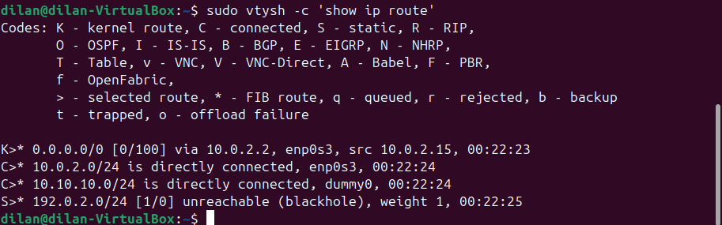
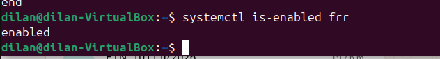
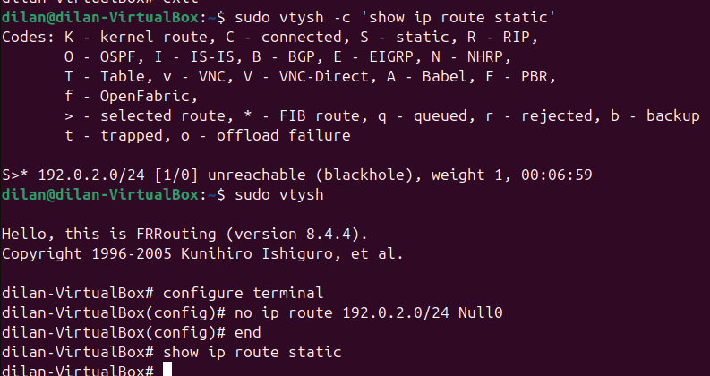
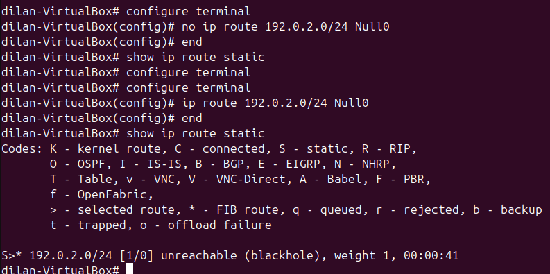
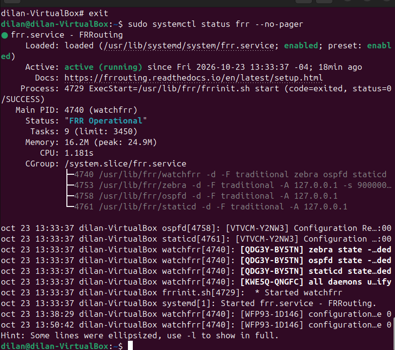

<div align="center">

# UNIVERSIDAD — INFORME DE LABORATORIO

### ETN-1011 · LABORATORIO DE SISTEMAS DE COMUNICACIÓN II

---

# LABORATORIO N.º 2

## FRRouting en Ubuntu y equivalencias con Cisco IOS

**Universitario:** Vila Montero Dilan  
**Asignatura:** ETN-1011 — Laboratorio de Sistemas de Comunicación II  
**Fecha de práctica:** 23 de octubre de 2026  
**Entorno:** Ubuntu en Oracle VirtualBox  
**Herramientas:** FRRouting (FRR), Linux, Git y GitHub

---

**Informe técnico de configuración, verificación y diagnóstico de un router virtual**

</div>

## Índice

1. [Introducción](#1-introducción)
2. [Objetivos](#2-objetivos)
3. [Entorno y topología](#3-entorno-y-topología)
4. [Desarrollo de la práctica](#4-desarrollo-de-la-práctica)
5. [Evidencias](#5-evidencias)
6. [Equivalencias con Cisco IOS](#6-equivalencias-con-cisco-ios)
7. [Cuestionario de evaluación](#7-cuestionario-de-evaluación)
8. [Resultados y análisis](#8-resultados-y-análisis)
9. [Conclusiones](#9-conclusiones)
10. [Referencias](#10-referencias)

---

## 1. Introducción

FRRouting (FRR) es un conjunto de servicios de enrutamiento para sistemas Linux. Permite administrar rutas y protocolos desde la consola `vtysh`, con comandos similares a los empleados en Cisco IOS. En esta práctica se instaló y verificó FRR, se configuró una interfaz virtual, se estudiaron rutas conectadas y estáticas, se comprobó la persistencia y se examinó el funcionamiento de OSPF con un único router.

La guía original propone Ubuntu en WSL2; **esta ejecución se realizó en una máquina virtual Ubuntu sobre Oracle VirtualBox**. Por ello, la interfaz principal identificada fue `enp0s3` y no `eth0`. Se mantuvo la ruta predeterminada del sistema sin modificarla.

## 2. Objetivos

### Objetivo general

Configurar y verificar un router virtual mediante FRRouting en Ubuntu, identificando sus funciones de enrutamiento y las equivalencias conceptuales con Cisco IOS.

### Objetivos específicos

- Comprobar el entorno Linux y el funcionamiento de los servicios FRR.
- Crear y activar una interfaz virtual `dummy0` con direccionamiento IPv4.
- Identificar rutas conectadas y configurar una ruta estática de descarte.
- Verificar la relación entre la tabla de FRR y la tabla del kernel Linux.
- Guardar la configuración y comprobar su persistencia.
- Realizar pruebas de diagnóstico, eliminación y restauración de rutas.
- Configurar OSPF en un solo router e interpretar la ausencia de vecinos.

## 3. Entorno y topología

| Elemento | Configuración utilizada |
|---|---|
| Plataforma | Ubuntu instalado en Oracle VirtualBox |
| Usuario de Ubuntu | `dilan` |
| Equipo | `dilan-VirtualBox` |
| FRRouting | Versión 8.4.4 |
| Interfaz principal | `enp0s3` |
| IPv4 principal | `10.0.2.15/24` |
| Puerta de enlace | `10.0.2.2` |
| Interfaz de práctica | `dummy0` |
| IPv4 de práctica | `10.10.10.1/24` |
| Red conectada | `10.10.10.0/24` |
| Ruta de descarte usada | `192.0.2.0/24` hacia `Null0` |
| Área OSPF | Área 0 |

> **Adaptación documentada:** la guía ejemplifica la ruta `198.51.100.0/24 blackhole`. Durante nuestra ejecución se empleó `192.0.2.0/24 Null0`, con el mismo propósito de descarte. Ambos son prefijos reservados para documentación; el informe presenta la configuración realmente practicada.

```text
Equipo anfitrión
└── Oracle VirtualBox
    └── Ubuntu Linux
        └── Router R1 (FRRouting)
            ├── enp0s3: 10.0.2.15/24
            │   └── gateway: 10.0.2.2
            ├── dummy0: 10.10.10.1/24
            │   └── red conectada: 10.10.10.0/24
            ├── ruta estática: 192.0.2.0/24 → Null0
            └── OSPF: área 0, sin vecinos
```

## 4. Desarrollo de la práctica

### 4.1. Ejercicios 1 y 2 — Reconocimiento de Ubuntu y de la red

Se utilizó Ubuntu en VirtualBox como alternativa al entorno WSL2 de la guía. Se revisó la identificación del sistema y el direccionamiento mediante comandos de Linux:

```bash
whoami
ip -br addr
ip -4 route
```

Se identificó la interfaz `enp0s3`, con dirección `10.0.2.15/24`, y la puerta de enlace `10.0.2.2`. No se modificó la ruta por defecto.

### 4.2. Ejercicios 3 y 4 — Instalación y activación de FRRouting

Se instaló FRRouting y se habilitaron sus servicios. Los procesos principales utilizados fueron `zebra` y `staticd`. Se comprobó el estado del servicio:

```bash
sudo systemctl status frr --no-pager
sudo vtysh -c 'show version'
```

**Resultado:** FRRouting 8.4.4 se encontró operativo, con el servicio `frr` activo. También se comprobó que estaba habilitado para iniciarse automáticamente.





### 4.3. Ejercicio 5 — Exploración de `vtysh`

Se ingresó a la consola de FRR para consultar el estado del router:

```text
sudo vtysh
show version
show ip route
show running-config
```

Se distinguió la consola Linux (`$`) de la consola FRR (`#`). `show running-config` permitió observar la configuración administrada por FRR.



### 4.4. Ejercicio 6 — Creación de la interfaz virtual `dummy0`

Se creó una interfaz virtual para representar la red del laboratorio, sin necesitar una segunda máquina:

```bash
sudo ip link add dummy0 type dummy
sudo ip addr add 10.10.10.1/24 dev dummy0
sudo ip link set dummy0 up
ip -br addr show dummy0
```

**Resultado:** `dummy0` quedó activa con `10.10.10.1/24`. En una interfaz de tipo *dummy* es normal observar el estado `UNKNOWN` aunque esté administrativamente activa. Se verificó conectividad local con `ping` a `10.10.10.1`, sin pérdida de paquetes.


### 4.5. Ejercicio 7 — Consulta de rutas conectadas

Se verificaron las redes directamente conectadas:

```bash
sudo vtysh -c 'show ip route connected'
```

Se observaron las redes `10.0.2.0/24` y `10.10.10.0/24`. La segunda corresponde a la dirección configurada en `dummy0`.



### 4.6. Ejercicios 8 y 9 — Ruta estática de descarte y verificación en Linux

Se configuró una ruta estática de descarte en FRR:

```text
configure terminal
ip route 192.0.2.0/24 Null0
end
show ip route static
```

La tabla de FRR mostró una entrada estática hacia `192.0.2.0/24` con comportamiento de descarte (*blackhole*). En Linux se verificó con:

```bash
ip -4 route show 192.0.2.0/24
```

**Resultado observado:** `blackhole 192.0.2.0/24 proto static metric 20`. Esta coincidencia demuestra que la ruta configurada en FRR también se instaló en la tabla del kernel.

### 4.7. Ejercicios 10 y 11 — Configuración activa y persistencia

Se revisó la configuración y se guardó mediante:

```text
show running-config
show ip route static
write memory
```

La configuración se almacenó en `/etc/frr/frr.conf`. Se habilitó además un servicio de `systemd` denominado `dummy0.service` para recrear la interfaz virtual al iniciar Ubuntu. Tras reiniciar la máquina, se comprobó que la interfaz y la ruta estática seguían disponibles.

> `write memory` guarda la configuración de FRR, pero no convierte por sí solo en persistentes las interfaces temporales creadas con `ip link`. Por eso se utilizó una medida adicional para `dummy0`.



### 4.8. Ejercicio 12 — Eliminación y restauración de la ruta

Se eliminó temporalmente la ruta de descarte:

```text
configure terminal
no ip route 192.0.2.0/24 Null0
end
show ip route static
```

La ruta dejó de aparecer en la consulta de rutas estáticas. Luego se restauró:

```text
configure terminal
ip route 192.0.2.0/24 Null0
end
show ip route static
write memory
```

**Resultado:** la ruta volvió a mostrarse y se guardó nuevamente.





### 4.9. Ejercicio 13 — Prueba de descarte de paquetes

Se realizaron las pruebas:

```bash
ip route get 192.0.2.10
ping -c 2 192.0.2.10
```

Se observó `RTNETLINK answers: Invalid argument` en la consulta de ruta y `ping: connect: Argumento inválido` en el intento de comunicación. Esto es coherente con el tratamiento de una ruta de descarte en el kernel: el destino no se puede alcanzar mediante una ruta normal.

### 4.10. Ejercicio 14 — Estado y contadores de interfaces

Se consultaron las estadísticas y el estado de `dummy0`:

```bash
ip -s link show dummy0
sudo vtysh -c 'show interface dummy0'
```

**Resultado:** interfaz activa, MTU de 1500 bytes y ausencia de errores reportados en la comprobación. La información permitió contrastar la vista de Linux con la de FRR.

### 4.11. Ejercicio 15 — Diagnóstico mediante registros

Se examinaron el estado y los eventos del servicio:

```bash
sudo systemctl status frr --no-pager
sudo journalctl -u frr -n 50 --no-pager
```

Los registros mostraron el inicio de FRR y de procesos como `zebra`, `staticd` y, posteriormente, `ospfd`. La verificación final confirmó que el servicio estaba activo.



### 4.12. Ejercicio 16 — Configuración y observación de OSPF

Inicialmente, el comando `show ip ospf neighbor` indicó que `ospfd` no estaba en ejecución. Se habilitó el proceso y se configuró OSPF para la red de práctica:

```bash
sudo sed -i 's/^ospfd=no/ospfd=yes/' /etc/frr/daemons
sudo systemctl restart frr
```

```text
configure terminal
router ospf
network 10.10.10.0/24 area 0
end
show ip ospf interface
show ip ospf neighbor
write memory
```

**Resultado:** OSPF quedó habilitado en `dummy0`, dentro del área 0, con identificador de router `10.10.10.1`. No se observaron vecinos OSPF, lo cual es **esperado** porque el laboratorio dispone de un solo router. La configuración se guardó correctamente.

## 5. Evidencias

Las nueve capturas se conservan en el directorio [`evidencias/`](evidencias/) del mismo repositorio que este informe. Se incluyen dentro de los apartados correspondientes y se relacionan de la siguiente manera:

| Archivo | Contenido |
|---|---|
| `01_version_frr.png` | Versión instalada de FRRouting |
| `02_servicio_frr.png` | Estado del servicio FRR |
| `03_interfaz_dummy0.png` | Dirección y estado de `dummy0` |
| `04_tabla_rutas.png` | Tabla de enrutamiento |
| `05_configuracion_frr.png` | Configuración activa |
| `06_persistencia_frr.png` | Habilitación/persistencia del servicio |
| `07_ruta_eliminada.png` | Eliminación de la ruta estática |
| `08_ruta_restaurada.png` | Restauración de la ruta estática |
| `09_verificacion_final_frr.png` | Comprobación final del servicio |

**Alcance de la evidencia:** las capturas documentan los estados indicados; las pruebas adicionales descritas en el desarrollo se registraron durante la ejecución, aunque no todas tienen una captura individual.

## 6. Equivalencias con Cisco IOS

| Operación | Linux / FRRouting | Cisco IOS |
|---|---|---|
| Ver interfaces | `ip -br addr` / `show interface` | `show ip interface brief` |
| Ver rutas | `ip -4 route` / `show ip route` | `show ip route` |
| Acceder a consola | `sudo vtysh` | `enable` |
| Configurar | `configure terminal` | `configure terminal` |
| Asignar IP | `ip addr add ... dev ...` | `interface ...` + `ip address ...` |
| Activar interfaz | `ip link set ... up` | `no shutdown` |
| Ruta estática de descarte | `ip route 192.0.2.0/24 Null0` | `ip route 192.0.2.0 255.255.255.0 Null0` |
| Configuración activa | `show running-config` | `show running-config` |
| Guardar | `write memory` | `copy running-config startup-config` |
| Registros | `journalctl -u frr` | `show logging` |
| Vecinos OSPF | `show ip ospf neighbor` | `show ip ospf neighbor` |

Las equivalencias son funcionales y aproximadas; Linux, FRR y Cisco IOS no administran todas las interfaces y los servicios de la misma manera.

## 7. Cuestionario de evaluación

**1. ¿Qué diferencia hay entre FRR y el kernel Linux?**  
FRR administra el plano de control del enrutamiento y coordina las rutas; el kernel Linux mantiene la tabla de rutas efectiva y realiza el reenvío de paquetes.

**2. ¿Qué función cumple `zebra`?**  
Coordina la información de interfaces y rutas entre los procesos de FRR y el kernel Linux.

**3. ¿Qué diferencia hay entre `show ip route` e `ip -4 route`?**  
El primero presenta la información desde FRR; el segundo muestra las rutas IPv4 instaladas en el kernel Linux.

**4. ¿Qué conserva `write memory`?**  
Guarda la configuración de FRR en su archivo de configuración, pero no guarda automáticamente las interfaces temporales creadas con comandos Linux.

**5. ¿Por qué no aparecen vecinos OSPF?**  
Porque solo existe un router OSPF en la topología y no hay otro dispositivo con el que establecer una adyacencia.

**6. ¿Qué hace una ruta `blackhole`?**  
Descarta los paquetes dirigidos a la red de destino, evitando que sigan una ruta de reenvío normal.

**7. ¿Cuál es la equivalencia de `write memory` en Cisco IOS?**  
`copy running-config startup-config`.

**8. ¿Por qué la configuración de una IP se hace fuera de `vtysh` en este laboratorio?**  
Porque la interfaz virtual se crea y administra inicialmente mediante las herramientas de red de Linux; FRR se utiliza principalmente para administrar el enrutamiento y los protocolos.

## 8. Resultados y análisis

| Verificación | Resultado |
|---|---|
| FRRouting instalado | Versión 8.4.4 |
| Servicio FRR | Activo y habilitado |
| Interfaz virtual | `dummy0` con `10.10.10.1/24` |
| Ruta conectada | `10.10.10.0/24` |
| Ruta estática | `192.0.2.0/24` con descarte |
| Comparación FRR/Linux | Ruta observada en ambas tablas |
| Persistencia | Configuración y `dummy0` verificadas tras reinicio |
| Eliminación/restauración | Ejecutadas y verificadas |
| Prueba de descarte | Comunicación rechazada según el comportamiento esperado |
| OSPF | Área 0 configurada, sin vecinos |

Los resultados permiten distinguir dos componentes complementarios: **FRR administra la configuración y el aprendizaje de rutas**, mientras **Linux aplica las rutas en su propia pila de red**. La prueba de eliminación y restauración demuestra que los cambios en FRR afectan el estado de enrutamiento. La ausencia de vecinos OSPF no representa una falla, sino una limitación deliberada de la topología de un solo router.

## 9. Conclusiones

1. Se verificó el funcionamiento de FRRouting en Ubuntu dentro de VirtualBox, comprobando la operación del servicio y su integración con Linux.
2. La interfaz virtual `dummy0` permitió practicar direccionamiento y rutas conectadas sin requerir equipos físicos adicionales.
3. La ruta estática de descarte permitió observar la instalación de rutas en Linux y el rechazo del tráfico hacia un prefijo determinado.
4. Se comprobó la importancia de guardar la configuración de FRR y de configurar por separado la persistencia de interfaces virtuales.
5. La configuración de OSPF permitió identificar que una vecindad requiere al menos otro router conectado y correctamente configurado.
6. La comparación con Cisco IOS facilitó reconocer comandos equivalentes y diferencias entre la administración de red en Linux y en un router Cisco.

## 10. Referencias

- **Guía de la materia:** *Guía de laboratorio: FRRouting en WSL/Ubuntu y equivalencias con Cisco IOS*, repositorio `ETN1011/2026-s2`, carpeta `lab2`.
- **Documentación oficial de FRRouting:** FRRouting User Guide.
- **Manual de Linux:** herramientas `iproute2`, `systemctl` y `journalctl`.

---

<div align="center">

**ETN-1011 · Laboratorio N.º 2**  
**Vila Montero Dylan**  
*Trabajo documentado con Markdown, Git y GitHub*

</div>
